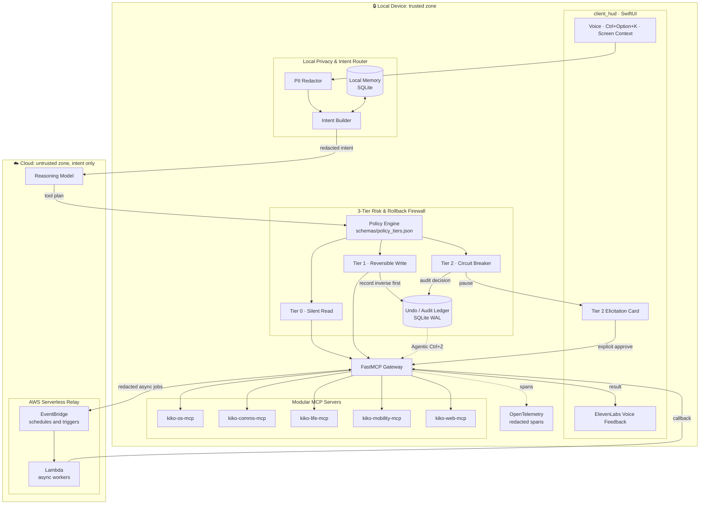
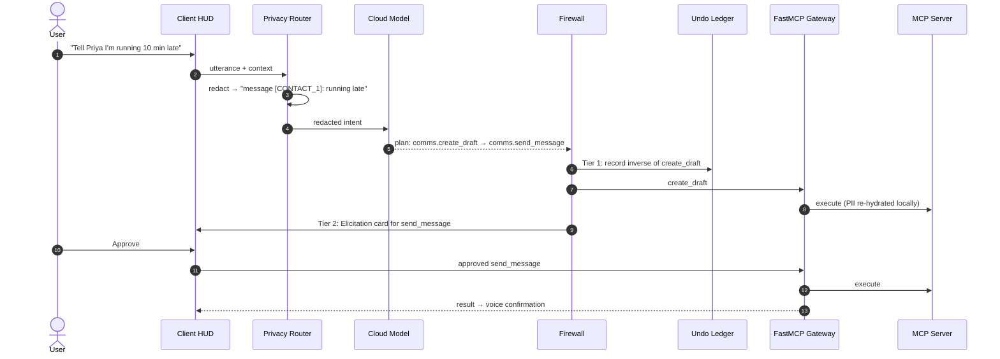

# K.I.K.O. Architecture

> **Your data stays local. Only intent hits the cloud.**

K.I.K.O. is designed as a kernel. It sits between the user and every MCP capability on the machine. The kernel owns privacy, policy and rollback, and the MCP servers only carry out actions. This document describes the components, the trust boundaries and how a request moves through the system.

## System Diagram

## Trust Boundary

There is exactly **one** path out of the device: the redacted intent that leaves the Privacy Router, plus the redacted async jobs sent to the AWS relay.

| Stays on-device | Crosses the boundary |
|---|---|
| Files, messages, contacts, screen content | Redacted intent (for example *"draft a reply to [CONTACT_1] about [EVENT_1]"*) |
| Local memory, the PII token map | Tool names and plans |
| Undo Ledger, tool results | Redacted async job payloads |

PII placeholders are re-hydrated **locally** in the gateway just before a tool runs. Cloud components never see the real values.

## Components

### 1. Client HUD (`client_hud/`)
A native macOS SwiftUI floating panel. It captures voice, the global hotkey and screen context, speaks results through ElevenLabs, and shows **MCP Elicitation cards** for Tier 2 approvals. It is the only place a Tier 2 approval can come from.

### 2. Local Privacy & Intent Router (`kernel/`)
- **PII Redactor:** swaps names, numbers, addresses and identifiers for stable placeholders and keeps the mapping on-device.
- **Local Memory:** SQLite-backed preferences and context, used to fill in intent without a cloud round-trip.
- **Intent Builder:** produces the smallest redacted request needed for reasoning.

### 3. 3-Tier Risk & Rollback Firewall (`kernel/`)
A deterministic policy engine that reads its rules from `schemas/policy_tiers.json`. The tier is looked up from that file and is never inferred by a model.

| Tier | Side effects | Gate | Ledger | Guarantee |
|---|---|---|---|---|
| **0: Silent Read** | none | none | not recorded | No side effects, so it can run autonomously |
| **1: Reversible Write** | local | the `undo` ledger entry must be written first | `undo` entry | Every action has a recorded inverse (`restore_snapshot` or `delete_created`) that **Agentic Ctrl+Z** replays, newest first |
| **2: Circuit Breaker** | local or external | explicit approval via MCP Elicitation | `audit` entry | Nothing irreversible runs without a human decision |

**Invariants** (pinned as `const` in `schemas/policy_tiers.schema.json`)
- **Fail closed:** tools that aren't listed are treated as Tier 2.
- **Ledger first:** a Tier 1 action that cannot record its inverse does not run.
- **External means Tier 2:** any tool with external side effects is Tier 2.
- **No bypass:** no flag, prompt or config can skip the Tier 2 confirmation. Only the local HUD (`client_hud`) can approve, never a cloud component or an AWS trigger.
- **Bound approvals:** an approval covers the `arguments_sha256` it was shown. The gateway re-hashes the arguments at execution time and refuses if they differ. Requests expire after `approval_ttl_seconds` (120 s).

### 4. FastMCP Gateway (`kernel/`)
The only component that talks to the MCP servers. It routes approved calls to the right server, re-hydrates PII locally, emits redacted OpenTelemetry spans, and dispatches jobs that should run later to the AWS relay.

### 5. AWS Serverless Relay (`kernel/`)
Handles async and time-based triggers, such as *"remind me when it's time to leave"* or *"follow up if no reply by 5 pm"*. **EventBridge** schedules the job, **Lambda** runs it, and the result comes back to the gateway as a callback. Payloads are redacted intent only. Any action a trigger leads to goes back through the firewall when it returns.

### 6. Modular MCP Servers (`mcp_servers/`)
Each server is self-contained and owns one domain. Tools follow the `<domain>.<verb_object>` naming scheme. Servers never call each other directly; everything goes through the gateway.

| Server | Domain | Tier 0 | Tier 1 | Tier 2 |
|---|---|---|---|---|
| `kiko-os-mcp` | Files, windows | `read_active_window`, `semantic_file_search` | `organize_files` | `delete_file` |
| `kiko-comms-mcp` | Messaging | — | `create_draft` | `send_message` |
| `kiko-life-mcp` | Calendar | `get_calendar_events` | `create_calendar_block` | — |
| `kiko-mobility-mcp` | Commute | `estimate_eta` | — | `stage_ride_deeplink` |
| `kiko-web-mcp` | Headless web | — | — | `submit_external_form` |

## Request Lifecycle

## Source of Truth

| Concern | Location |
|---|---|
| Tool → tier, undo strategy, privacy rules, policy version | `schemas/policy_tiers.json` |
| Risk classification contract and tier invariants | `schemas/policy_tiers.schema.json` |
| Undo / audit ledger row contract | `schemas/ledger_entry.schema.json` |
| Tier 2 approval request / response contract | `schemas/elicitation.schema.json` |
| Reference payloads | `schemas/examples/` |
| Consistency check (policy ↔ schemas ↔ docs) | `python3 schemas/check_consistency.py` |
| Engineering conventions | `CLAUDE.md` |
