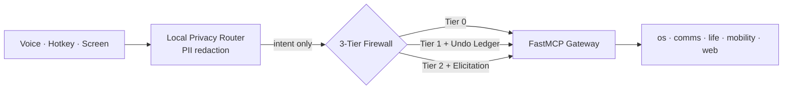

# K.I.K.O. — Knowledge Injected Kernel Orchestrator

> **Your data stays local. Only intent hits the cloud.**

K.I.K.O. is an OS-native autonomy kernel that brings the Model Context Protocol (MCP) to everyday users. You press **`Ctrl + Option + K`** or speak, and K.I.K.O. handles your files, messages, calendar, commute and web tasks. There is no JSON config and no IDE, and every action passes through a deterministic safety firewall.

**Team KERNOPS** · Dayananda Sagar University · **wHACKiest 2026 (MSRIT)** · **Track T-1: Make MCP Matter**

---

## Why K.I.K.O.

MCP is powerful but hard to reach. Today it lives inside developer IDEs and hand-edited config files, and the agents built on it send raw personal data to the cloud and act with little guarding. K.I.K.O. changes three things:

| Problem | K.I.K.O. |
|---|---|
| MCP is locked inside developer tooling | **Zero-config, OS-native kernel** driven by voice and a global hotkey |
| Agents send raw personal data to the cloud | **Local privacy router.** PII is redacted on-device, and only the intent goes out. |
| Agents act without guardrails | **3-Tier Risk & Rollback Firewall.** Reads run silently, writes can be undone, and irreversible actions need your confirmation. |

## How It Works



See **[ARCHITECTURE.md](ARCHITECTURE.md)** for the full system design, trust boundaries and request lifecycle.

## 3-Tier Risk & Rollback Firewall

| Tier | Class | Behavior | Example tools |
|---|---|---|---|
| **0: Silent** | Read-only | Runs autonomously with no side effects | `os.semantic_file_search`, `life.get_calendar_events` |
| **1: Reversible** | Local writes | Runs immediately and is recorded in the SQLite Undo Ledger for one-click **Agentic Ctrl+Z** | `os.organize_files`, `comms.create_draft` |
| **2: Circuit Breaker** | Irreversible or external | Stops until you confirm through an **MCP Elicitation** card, and the decision is recorded in the audit ledger | `comms.send_message`, `os.delete_file` |

Tier assignments are declared in [`schemas/policy_tiers.json`](schemas/policy_tiers.json). The firewall reads them from that file and never lets a model decide them. A tool that isn't listed fails closed to Tier 2. An approval applies only to the exact arguments shown on the card, and it expires after 120 seconds.

## Repository Map

```
kiko-mcp-kernel/
├── kernel/
│   ├── policy.py           deterministic tier evaluation (fail closed)
│   ├── firewall.py         3-tier dispatch · Agentic Ctrl+Z
│   ├── ledger.py           SQLite WAL Undo / Audit Ledger
│   ├── elicitation.py      Tier 2 approval build + verify
│   ├── redactor.py         on-device PII redaction / rehydration
│   ├── contracts.py        typed mirrors of schemas/
│   ├── gateway.py          FastMCP routing (stub)
│   ├── relay.py            AWS EventBridge relay (stub)
│   └── config.py           env-only settings
├── mcp_servers/            one server.py per domain: TOOLS + Tier 1 INVERSES
│   ├── kiko-os-mcp/        files, active window, semantic search
│   ├── kiko-comms-mcp/     drafts and messaging
│   ├── kiko-life-mcp/      calendar and scheduling
│   ├── kiko-mobility-mcp/  ETA and ride staging
│   └── kiko-web-mcp/       headless web tasks
├── tests/                  stdlib unittest suite
├── client_hud/             SwiftUI floating HUD · ElevenLabs voice · Tier 2 approval cards
├── schemas/
│   ├── policy_tiers.json             tool → tier, undo strategy, privacy rules
│   ├── policy_tiers.schema.json      risk classification contract
│   ├── ledger_entry.schema.json      Undo / audit ledger row contract
│   ├── elicitation.schema.json       Tier 2 approval request / response contract
│   ├── examples/                     reference payloads
│   └── check_consistency.py          policy ↔ schemas ↔ docs checker
├── pyproject.toml          package + optional extras (servers, aws, dev)
├── .env.example            every supported env var, no values
├── ARCHITECTURE.md         system design
└── CLAUDE.md               engineering conventions
```

## Developer Quickstart

> **Status:** the policy engine, firewall, Undo / Audit Ledger, approval verification and PII redactor are implemented and tested. The gateway, AWS relay, MCP tool bodies and HUD are typed stubs marked `TODO(sprint)`. Steps marked ⏳ start working once those land.

**Prerequisites:** macOS 14+, Python 3.11+, Xcode 15+, and AWS credentials (only needed for the async relay).

```bash
# 1. Clone
git clone https://github.com/jhaaryan2305/kiko-mcp-kernel.git && cd kiko-mcp-kernel

# 2. Check that the policy, schemas and docs agree
#    (pip install 'jsonschema>=4.18' to also run full JSON Schema validation)
python3 schemas/check_consistency.py

# 3. Kernel: set up the environment, run the tests, validate the policy and open the ledger
python3 -m venv .venv && source .venv/bin/activate
pip install -e ".[dev,servers]"
cp .env.example .env            # optional; every value has a safe default
python -m unittest              # policy, ledger, firewall, redactor, server contracts
python -m kernel                # ⏳ gateway start-up lands next

# 4. ⏳ Run an MCP server standalone (tools are stubs until implemented)
python mcp_servers/kiko-os-mcp/server.py

# 5. ⏳ HUD: build and run the macOS client
open client_hud/*.xcodeproj
```

Secrets such as AWS and ElevenLabs keys are read from environment variables. Never commit them.

## Team KERNOPS

- Aryan Jha (Lead) — ENG26AM0739
- Deepti Sunil — ENG26CS0565
- Aayush Srivastava — ENG26AM0344
- Shubham Kumar Sah — ENG26AM0711
